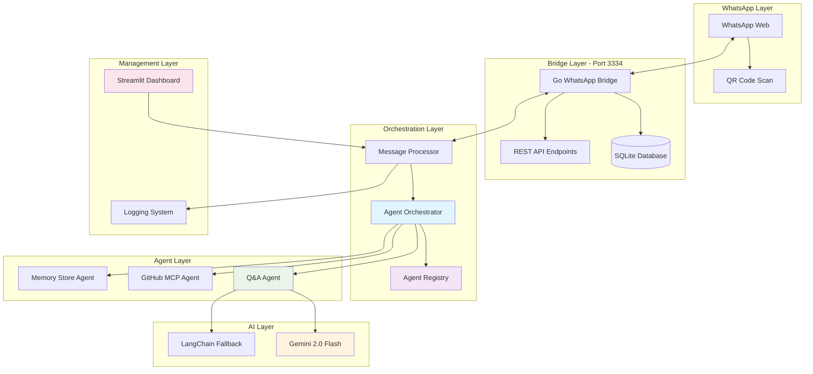
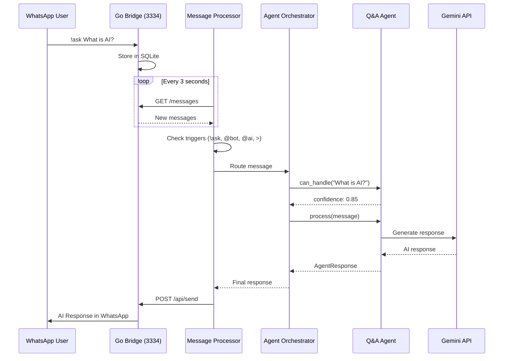

# 🏗️ WhatsApp AI Assistant - System Architecture

## 📋 Overview

The WhatsApp AI Assistant is a **multi-agent orchestration system** that connects your personal WhatsApp with AI agents powered by Google Gemini. The system uses a trigger-based approach with intelligent routing to multiple specialized agents.

## 🎯 Current Architecture (2025)



## 🔄 Message Flow Diagram



## 🏢 Component Architecture

### **1. WhatsApp Bridge Layer**

- **Technology**: Go + Whatsmeow library
- **Port**: 3334
- **Purpose**: Connects to WhatsApp Web and exposes REST API
- **Database**: SQLite for message persistence
- **Key Files**: `whatsapp-mcp/whatsapp-bridge/main.go`

### **2. Message Processing Layer**

- **Technology**: Python asyncio
- **Purpose**: Polls bridge, processes triggers, routes to orchestrator
- **Key Files**: `core/message_processor.py`
- **Triggers**: `!ask`, `@bot`, `@ai`, `>`

### **3. Agent Orchestration Layer**

- **Technology**: Python with confidence-based routing
- **Purpose**: Routes messages to best available agent
- **Key Files**:
  - `agents/orchestrator.py`
  - `agents/registry.json`
  - `agents/base_agent.py`

### **4. Agent Layer**

- **Current Agents**:
  - Q&A Agent (Gemini 2.0 Flash)
  - GitHub MCP Agent (repository operations)
  - Memory Store Agent (long-term memory)
- **Technology**: Direct GenAI API + LangChain fallback
- **Purpose**: Specialized AI responses
- **Key Files**: `agents/qna_agent.py`

### **5. Management Layer**

- **Dashboard**: Streamlit web interface (Port 8503)
- **Logging**: Structured logging with status indicators
- **Key Files**: `dashboard/streamlit_app.py`, `main.py`

## 🗂️ File Structure

```
whatsapp-agent/
├── agents/                          # Multi-agent system
│   ├── __init__.py
│   ├── base_agent.py               # Abstract agent class
│   ├── orchestrator.py             # Agent routing logic
│   ├── qna_agent.py               # Q&A specialist agent
│   └── registry.json              # Agent configuration
├── config/                         # Configuration management
│   ├── __init__.py
│   └── settings.py                # Environment settings
├── core/                          # Core system components
│   ├── __init__.py
│   ├── ai_agent.py               # LangChain integration
│   ├── message_processor.py      # Message orchestration
│   └── whatsapp_client.py        # Bridge API client
├── dashboard/                     # Web interface
│   ├── __init__.py
│   ├── simple_send.py           # Simple message interface
│   └── streamlit_app.py         # Full dashboard
├── docs/                         # Documentation
├── logs/                         # Application logs
├── whatsapp-mcp/                # Modified WhatsApp bridge
│   └── whatsapp-bridge/
│       ├── main.go              # Go bridge server
│       └── store/               # SQLite databases
├── .env                         # Environment configuration
├── main.py                      # Main application entry
└── requirements.txt             # Python dependencies
```

## 🔧 Configuration Architecture

### **Environment Variables (.env)**

```env
# API Keys
GEMINI_API_KEY=your-google-gemini-api-key

# Bridge Configuration
MCP_SERVER_URL=http://localhost:3334
MCP_POLL_INTERVAL=3

# Bot Behavior
BOT_NAME=AI Assistant
BOT_TRIGGERS=!ask,@bot,@ai,>
AUTHORIZED_NUMBERS=               # Empty = allow all
ENABLE_GROUP_CHATS=true
ENABLE_PERSONAL_CHATS=true

# Agent Configuration
AGENT_MODEL=gemini-2.0-flash
AGENT_TEMPERATURE=0.7
MAX_RESPONSE_LENGTH=500

# Logging
LOG_LEVEL=INFO
ENABLE_CONSOLE_LOGS=true
ENABLE_FILE_LOGS=true

# Dashboard
DASHBOARD_PORT=8503
DASHBOARD_HOST=localhost
```

### **Agent Registry (agents/registry.json)**

```json
{
  "agents": [
    {
      "id": "qna-chatbot",
      "name": "Q&A Assistant",
      "description": "General question answering and explanations",
      "capabilities": [
        "general-qa",
        "factual-questions",
        "explanations",
        "reasoning"
      ],
      "model": "gemini-2.0-flash",
      "temperature": 0.7,
      "max_tokens": 500,
      "enabled": true
    }
  ],
  "routing_rules": {
    "default_agent": "qna-chatbot",
    "keywords": {
      "qna-chatbot": ["what", "how", "why", "explain", "ask"]
    }
  },
  "system_config": {
    "max_concurrent_agents": 3,
    "response_timeout": 30,
    "fallback_enabled": true
  }
}
```

## 📊 Data Flow Architecture

### **1. Message Ingestion**

```
WhatsApp → Go Bridge → SQLite → Python Polling → Trigger Detection
```

### **2. Agent Orchestration**

```
Message → Orchestrator → Agent Selection → Processing → Response
```

### **3. Response Delivery**

```
Agent Response → Message Processor → Bridge API → WhatsApp
```

## 🎛️ Port Configuration

| Service             | Port | Purpose          |
| ------------------- | ---- | ---------------- |
| Go WhatsApp Bridge  | 3334 | Main API server  |
| Streamlit Dashboard | 8503 | Web interface    |
| Python AI Assistant | N/A  | Connects to 3334 |

## 🔄 Process Architecture

### **Main Process (main.py)**

- Initializes logging system
- Starts message processor
- Handles graceful shutdown
- Status monitoring

### **Message Processor**

- Polls bridge every 3 seconds
- Processes triggers
- Routes to orchestrator
- Handles responses

### **Agent Orchestrator**

- Loads agent registry
- Calculates confidence scores
- Routes to best agent
- Manages fallbacks

### **Bridge Process (Go)**

- WhatsApp Web connection
- REST API server
- SQLite data persistence
- Message queuing

## 🚀 Scaling Architecture

### **Current State: Single-Agent**

- One Q&A agent
- Direct Gemini integration
- Local SQLite storage

### **Future State: Multi-Agent**

- Multiple specialized agents
- Agent-to-agent communication
- Distributed processing
- Vector database integration

## 🔐 Security Architecture

### **Current Security**

- Local-only processing
- No external dependencies
- Optional number authorization
- Encrypted WhatsApp bridge

### **Recommended Enhancements**

- API authentication tokens
- Rate limiting
- Message encryption
- Audit logging

This architecture provides a solid foundation for a scalable, multi-agent WhatsApp AI assistant system.
