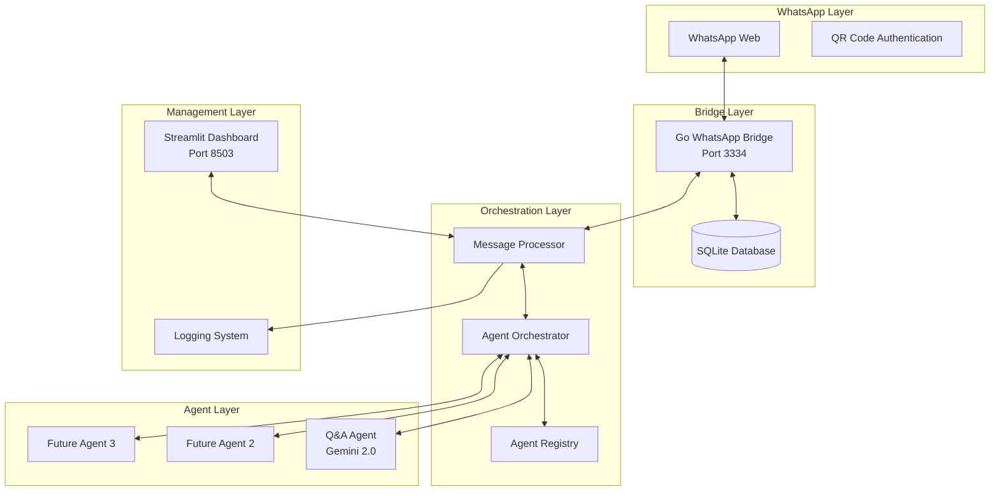

# 🤖 WhatsApp AI Assistant

A sophisticated **multi-agent orchestration system** that connects your personal WhatsApp with specialized AI agents powered by Google Gemini 2.0 Flash. Features intelligent routing, trigger-based responses, and a comprehensive dashboard.

## 🎯 Features

- **🧠 Multi-Agent System**: Intelligent routing to specialized AI agents
- **💬 WhatsApp Integration**: Works with personal and group chats via whatsapp-mcp
- **🎛️ Trigger-Based**: Responds to `!ask`, `@bot`, `@ai`, `>` commands
- **📊 Real-time Dashboard**: Streamlit-based monitoring and testing interface
- **🔧 Modular Architecture**: Easily extensible agent system
- **📈 Analytics**: Agent performance tracking and confidence scoring
- **🚀 Self-Invocation**: You can test the bot by messaging yourself

## 🏗️ Architecture



## 🚀 Quick Start

### 1. Prerequisites

- Python 3.10+
- Go 1.19+ (for whatsapp-mcp)
- Google Gemini API Key

### 2. Setup WhatsApp MCP Bridge (Already Cloned & Modified)

The WhatsApp MCP bridge has been cloned and modified to work with our AI assistant:

```bash
# Start the modified WhatsApp bridge
./start_whatsapp_bridge.sh     # Linux/Mac
# or start_whatsapp_bridge.bat  # Windows
```

**On first run:** Scan the QR code with your WhatsApp mobile app to authenticate.

### 3. Setup AI Assistant

```bash
# Create virtual environment
python -m venv venv
source venv/bin/activate  # Linux/Mac
# or venv\Scripts\activate  # Windows

# Install dependencies
pip install -r requirements.txt

# Configure environment
cp .env.example .env
# Edit .env with your Gemini API key
```

### 4. Configure Environment

Edit `.env` file:

```env
GEMINI_API_KEY=your-google-gemini-api-key-here
MCP_SERVER_URL=http://localhost:3334
BOT_NAME=AI Assistant
BOT_TRIGGERS=!ask,@bot,@ai,>
```

### 5. Run the Complete System

**Terminal 1 - Start WhatsApp Bridge:**

```bash
./start_whatsapp_bridge.sh     # Linux/Mac
# or start_whatsapp_bridge.bat  # Windows
```

**Terminal 2 - Start AI Assistant:**

```bash
python main.py
```

**Terminal 3 - Start Dashboard (Optional):**

```bash
python run_dashboard.py
```

Visit `http://localhost:8503` for the dashboard.

## 💬 Usage

### Triggering the Bot

The bot responds to these triggers:

- `!ask What is AI?`
- `@bot Hello there`
- `@ai How are you?`
- `> Tell me a joke`

### Configuration Options

| Setting                 | Description                         | Default            |
| ----------------------- | ----------------------------------- | ------------------ |
| `BOT_TRIGGERS`          | Comma-separated trigger phrases     | `!ask,@bot,@ai,>`  |
| `AUTHORIZED_NUMBERS`    | Allowed phone numbers (empty = all) | ``                 |
| `ENABLE_GROUP_CHATS`    | Allow bot in group chats            | `true`             |
| `ENABLE_PERSONAL_CHATS` | Allow bot in personal chats         | `true`             |
| `AGENT_MODEL`           | AI model for responses              | `gemini-2.0-flash` |
| `MAX_RESPONSE_LENGTH`   | Maximum response length             | `500`              |
| `AGENT_TEMPERATURE`     | LLM creativity (0.0-1.0)            | `0.7`              |

## 📊 Dashboard Features

### Overview Tab

- Message processing statistics
- Response time analytics
- Activity charts and trends

### Recent Messages Tab

- Live feed of conversations
- Query/response pairs
- Processing time metrics

### Test Agent Tab

- Test AI responses without WhatsApp
- Quick test scenarios
- Performance benchmarking

### Logs Tab

- System configuration
- Connection health checks
- Available WhatsApp chats

## 🛠️ Development

### Project Structure

```
whatsapp-ai-assistant/
├── config/
│   ├── __init__.py
│   └── settings.py              # Environment configuration
├── core/
│   ├── __init__.py
│   ├── ai_agent.py              # LangGraph + Gemini agent
│   ├── message_processor.py     # Orchestration logic
│   └── whatsapp_client.py       # REST API client
├── dashboard/
│   ├── __init__.py
│   └── streamlit_app.py         # Web dashboard
├── docs/
│   └── project.md               # Project documentation
├── whatsapp-mcp/               # Modified WhatsApp bridge
│   ├── whatsapp-bridge/
│   │   ├── main.go             # Modified Go bridge (REST API server)
│   │   ├── go.mod
│   │   └── go.sum
│   └── whatsapp-mcp-server/    # Original Python MCP server
├── logs/                        # Application logs
├── .env.example                 # Environment template
├── main.py                      # Main AI assistant
├── requirements.txt             # Python dependencies
├── run_dashboard.py             # Dashboard launcher
├── start_whatsapp_bridge.sh     # WhatsApp bridge starter (Unix)
├── start_whatsapp_bridge.bat    # WhatsApp bridge starter (Windows)
├── start.sh                     # AI assistant starter (Unix)
├── start.bat                    # AI assistant starter (Windows)
└── README.md                   # This file
```

### Adding New Features

1. **Custom Tools**: Extend `ai_agent.py` with LangChain tools
2. **Memory**: Add conversation history to LangGraph state
3. **Media Support**: Extend `whatsapp_client.py` for images/audio
4. **RAG**: Integrate vector databases for knowledge retrieval

### Testing

```bash
# Test individual components
python -c "from core.ai_agent import ai_agent; print(ai_agent.get_simple_response('Hello'))"
python -c "from core.whatsapp_client import whatsapp_client; print(whatsapp_client.health_check())"
```

## 🔧 Troubleshooting

### Common Issues

**1. "Cannot connect to WhatsApp MCP server"**

- Ensure the WhatsApp bridge is running: `./start_whatsapp_bridge.sh`
- Check if bridge is accessible: `curl http://localhost:3334/health`
- Verify WhatsApp Web authentication (scan QR code if needed)

**2. "Gemini API authentication failed"**

- Verify `GEMINI_API_KEY` in `.env` file
- Check Google AI Studio for valid API key

**3. "No new messages detected"**

- Verify trigger patterns in chat messages
- Check authorized numbers configuration
- Ensure chat type settings (personal/group)

**4. "Dashboard not loading"**

- Install Streamlit: `pip install streamlit`
- Check port 8503 availability
- Verify all dependencies are installed

### Logs

Check application logs in:

- Console output (real-time)
- `logs/whatsapp_ai_YYYY-MM-DD.log` (file logs)

## 🚀 Deployment

### Local Deployment

```bash
python main.py  # Run locally
```

### Docker Deployment

```bash
# Build image
docker build -t whatsapp-ai-assistant .

# Run container
docker run -d --env-file .env -p 8501:8501 whatsapp-ai-assistant
```

### Cloud Deployment

- **Render**: Deploy via GitHub integration
- **Railway**: Connect repository and deploy
- **Fly.io**: Use fly.toml configuration

## 🤝 Contributing

1. Fork the repository
2. Create feature branch: `git checkout -b feature/amazing-feature`
3. Commit changes: `git commit -m 'Add amazing feature'`
4. Push to branch: `git push origin feature/amazing-feature`
5. Open a Pull Request

## 📄 License

This project is licensed under the MIT License - see the [LICENSE](LICENSE) file for details.

## 🙏 Acknowledgments

- [Luke Harries](https://github.com/lharries) for whatsapp-mcp
- Google for Gemini API
- LangChain team for the frameworks
- Streamlit for the dashboard framework

---

**⚡ Start chatting with your AI assistant on WhatsApp today!**
