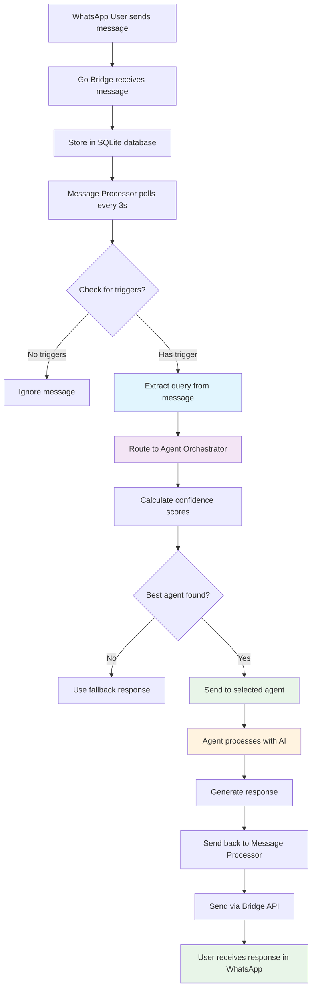
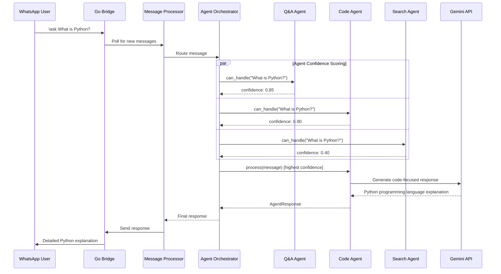
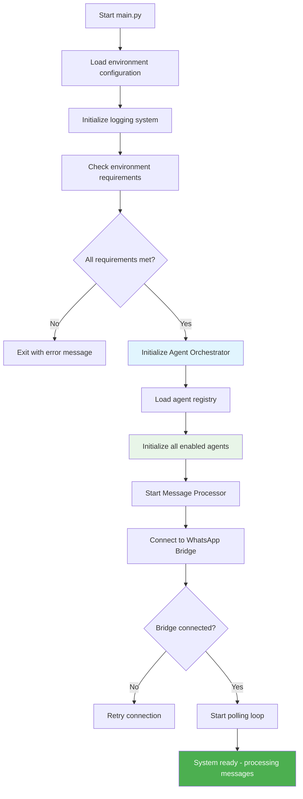
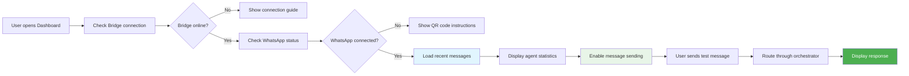
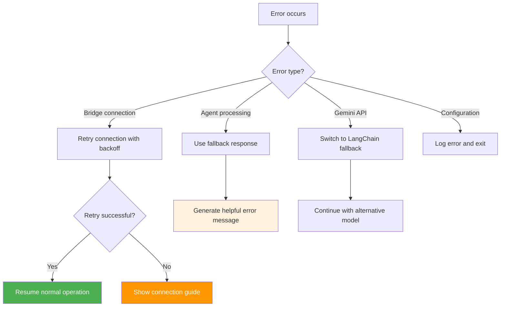
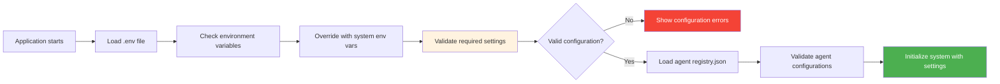
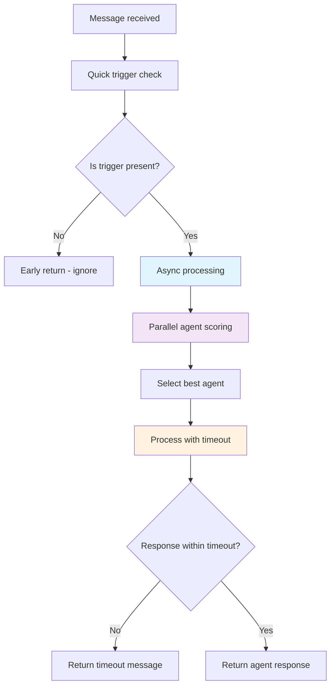
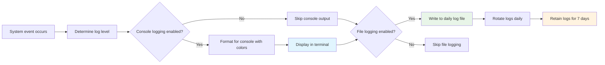

# í´„ WhatsApp AI Assistant - Workflow Documentation

## Message Processing Workflow



## Trigger Detection Process

```mermaid
flowchart LR
    A[Incoming Message] --> B{Starts with trigger?}
    B -->|!ask| C[Extract query after '!ask']
    B -->|@bot| D[Extract query after '@bot']
    B -->|@ai| E[Extract query after '@ai']
    B -->|>| F[Extract query after '>']
    B -->|No trigger| G[Ignore message]
    
    C --> H[Route to Orchestrator]
    D --> H
    E --> H
    F --> H
    
    style B fill:#fff3e0
    style H fill:#e1f5fe
```

## Agent Selection Workflow

```mermaid
flowchart TD
    A[Message arrives at Orchestrator] --> B[Load Agent Registry]
    B --> C[For each enabled agent]
    C --> D[Call agent.can_handle(message)]
    D --> E[Get confidence score 0.0-1.0]
    E --> F{More agents to check?}
    F -->|Yes| C
    F -->|No| G[Select agent with highest confidence]
    G --> H{Confidence > 0.5?}
    H -->|Yes| I[Route to selected agent]
    H -->|No| J[Use default Q&A agent]
    
    style G fill:#e1f5fe
    style I fill:#e8f5e8
    style J fill:#fff3e0
```

## Multi-Agent Response Flow



## System Startup Workflow



## Dashboard Interaction Workflow



## Error Handling Workflow



## Configuration Loading Workflow



## Message Types and Routing

### Personal Chat Messages
```
Format: !ask [query]
Example: "!ask What is machine learning?"
Flow: User → Bridge → Processor → Orchestrator → Agent → Response
```

### Group Chat Messages  
```
Format: @bot [query] or @ai [query]
Example: "@bot Explain quantum computing"
Flow: Group → Bridge → Processor → Orchestrator → Agent → Group
```

### Dashboard Messages
```
Format: Direct input via web interface
Flow: Dashboard → Orchestrator → Agent → Dashboard display
```

## Performance Optimization Workflow



## Logging and Monitoring Workflow



This workflow documentation provides a comprehensive view of how messages flow through the WhatsApp AI Assistant system, from initial reception to final response delivery.
